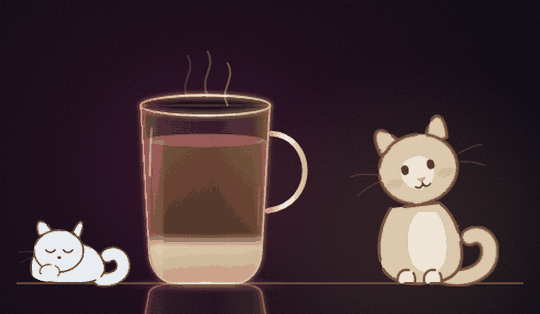

# 코피 주문기 · Kopi Order

**\*한국어** · [English](README.en.md)\*

싱가포르 호커센터에서 커피 시키는 법을 버튼으로 배우는 앱입니다.
`Kopi C Siu Dai Peng` 같은 주문 문장이 어떻게 조립되는지, 그 문장이 잔 안에서 무슨 뜻인지 보여줍니다.

**👉 Live: https://kopi-order.kopi-order-sg.workers.dev**



## 왜 만들었나

싱가포르 커피는 이름이 곧 레시피입니다. `O`는 우유 없이, `C`는 무가당 연유, `Kosong`은 설탕 없이, `Peng`은 얼음. 이 단어들을 순서대로 붙이면 주문이 되는데, 처음 가면 암호처럼 들려요. 검색해도 표로 정리된 것만 나와서, 눌러보면 잔 안이 바뀌는 쪽이 훨씬 빨리 이해될 것 같았습니다.

## 하는 일

- 음료·우유·단맛·농도·온도·포장을 고르면 실제 어순대로 주문 문장이 조립됩니다
- 잔 단면에 커피, 우유 띠, 각설탕, 얼음이 쌓이고 선택에 따라 실시간으로 바뀝니다
- 뜨거우면 머그에 김이 오르고, 얼음을 고르면 얼음잔으로, 포장을 고르면 봉지에 빨대가 꽂힌 모습으로 잔 자체가 변형됩니다
- 연유를 고르면 우유와 단맛이 붙어 움직입니다. 연유 자체가 달아서 그래요. 이런 함정은 잔 아래 한 줄로 알려줍니다
- 고양이 두 마리가 있습니다. 잔 오른쪽에 앉아 잔을 올려다보는 크림색 고양이는 가만히 있어도 숨을 쉬고 꼬리를 흔들고 귀를 씰룩이며, 눈동자가 마우스를 따라옵니다. 재료가 들어가면 잔 쪽으로 몸을 기울였다가 좋아서 깡충 뜁니다
- 잔 왼쪽에는 한 마리가 엎드려 자고 있습니다. 숨만 쉬어요. 호커센터엔 원래 고양이가 아무 데나 누워 있습니다
- 한국어 발음 표기와 브라우저 TTS 읽어주기. 싱글리시에 가까운 목소리를 우선 고릅니다
- 브라우저 언어에 따라 한국어/영어 자동 전환
- 각 단어의 어원. `少甜(시우 다이, 적게 달게)` 처럼 한자와 발음, 뜻을 같이 적었습니다

## 만든 방식

HTML 파일 하나에 [GSAP](https://gsap.com) 하나입니다. 빌드 없음, 프레임워크 없음. GSAP가 Webflow에 인수되면서 유료였던 플러그인이 전부 무료로 풀렸고, 이 앱은 그 플러그인들을 전제로 설계했습니다. 전부 `public/vendor/`에 직접 담아 두어 CDN 없이도 뜹니다. 폰트만 Google Fonts에서 불러오고, 막히면 시스템 글꼴로 떨어집니다.

그림은 전부 손으로 쓴 인라인 SVG입니다. 래스터 이미지가 한 장도 없어서 어느 화면에서도 선이 깨지지 않아요. 고양이는 손으로 그린 느낌을 노렸습니다. 외곽선에 불규칙한 `stroke-dasharray`를 줘서 선이 군데군데 끊기게 하고, 그 위에 아주 약한 난류 왜곡(`feTurbulence` + `feDisplacementMap`)을 걸어 자로 잰 듯한 벡터 티를 없앴습니다.

- **MorphSVG** — 머그·얼음잔·봉지가 각각 따로 있는 게 아니라 **path 하나가 세 모양 사이를 오갑니다.** 잔 내부를 자르는 `clipPath`도 같은 path를 `<use>`로 참조해서, 잔이 변형되면 액체가 잘리는 범위도 알아서 따라옵니다
- **Flip** — 선택 표시가 각 칩마다 따로 있는 게 아니라 **알약 하나가 칩 사이를 날아다닙니다.** DOM에서 위치만 옮기면 Flip이 그 전후 좌표를 재서 사이를 채워줍니다
- **SplitText** — 주문 문장이 바뀔 때 글자를 쪼개 아래에서 하나씩 세워 올립니다. 단어가 조립되는 느낌을 주려고요
- **DrawSVG** — 첫 화면에서 카운터 선과 잔이 순서대로 그려집니다. 붓는 줄기도 같은 방식으로 내려갔다 올라옵니다. 고양이에는 쓰지 않았어요. DrawSVG가 `stroke-dasharray`를 제 용도로 덮어쓰는데 고양이는 그 속성으로 끊어진 외곽선을 만들고 있어서, 같이 쓰면 손그림 느낌이 사라집니다. 대신 살짝 떠오르며 나타나게 했습니다
- **Physics2D** — 표면에 닿은 방울이 중력을 받아 튀고, 얼음과 각설탕이 떨어져 굴러 자리를 잡습니다
- **CustomEase · CustomBounce · CustomWiggle** — 버튼 눌림, 잔이 놓이는 반동, 수면이 흔들리는 파문, 귀 씰룩임. 기본 이징으로는 안 나오는 곡선이라 직접 그렸습니다
- **ScrollTrigger** — 아래 낱말 목록이 화면에 들어올 때 차례로 올라옵니다

그 밖에:

- 손떨림 필터는 움직이는 그룹 **안쪽**에 겁니다. 그래야 브라우저가 필터 결과를 한 번 계산해두고 변형만 다시 적용해요. 바깥에 걸면 숨 쉴 때마다 난류를 다시 계산하느라 프레임이 떨어집니다. 숨쉬기를 크기 변화가 아니라 위치 이동으로 만든 것도 같은 이유입니다
- 잔 상태는 애니메이션과 무관하게 즉시 반영됩니다. 애니메이션은 장식이지 진실의 원천이 아니에요
- 새 입력이 오면 진행 중인 타임라인을 죽이고 다시 만듭니다. 연타해도 상태가 안 꼬여요
- 잔 안이 실제로 달라졌을 때만 붓습니다. 포장 토글처럼 부을 게 없는 선택에는 연출이 안 나옵니다
- `prefers-reduced-motion`을 켠 사용자에게는 연출 없이 결과만 즉시 보여줍니다

## 로컬에서 보기

`public/index.html`을 브라우저로 그냥 열어도 됩니다. 읽어주기 버튼은 HTTPS나 `localhost`에서만 동작해요.

```bash
npm install
npm run dev        # http://localhost:8787
```

## 테스트

진짜 크로미움을 띄워서 실제로 칩을 눌러보고, 잔이 맞는 모양으로 바뀌었는지, 얼음과 각설탕 개수가 맞는지, 연타해도 상태가 안 꼬이는지, 연출이 끝난 뒤 파티클이 남지 않는지 확인합니다.

```bash
npx playwright install chromium   # 처음 한 번만
npm test
```

jsdom을 쓰지 않는 이유는, 이 앱이 path 길이와 `getBBox`, 레이아웃 좌표에 기대는 플러그인(MorphSVG, DrawSVG, Flip)을 쓰기 때문입니다. 가짜 DOM에서는 통과해도 의미가 없어요.

GSAP 버전을 올린 뒤에는 `npm run vendor`로 `public/vendor/`를 갱신하세요.

## 배포

Cloudflare Workers에 정적 자산으로 올립니다. 정적 파일 요청은 과금되지 않아서 무료 티어로 충분합니다.

```bash
npm run login      # 브라우저가 열리고 로그인. 토큰 복사 안 해도 됩니다
npm run deploy     # 30초쯤 뒤 https://kopi-order.kopi-order-sg.workers.dev
```

배포 후 할 일:

- Cloudflare 대시보드 → Workers & Pages → kopi-order → Settings → Builds 에서 이 저장소를 연결하면, 이후로는 push가 곧 배포입니다

커스텀 도메인은 같은 화면의 Domains & Routes 에서 붙일 수 있어요.

## 알아둘 것

- 가격은 대략적인 값입니다. 호커센터마다 다르고 자꾸 오릅니다
- `C`가 하이난어 鮮에서 왔다는 건 가장 널리 받아들여지는 설이지만 확정된 어원은 아닙니다
- 브라우저에 싱가포르 영어 목소리는 없습니다. 철자를 소리나는 대로 고쳐 넘기고 단어별로 끊어 발화해서 흉내 냅니다. 기기에 깔린 목소리에 따라 결과가 다릅니다

## 라이선스

MIT
